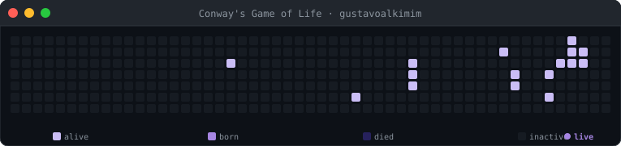
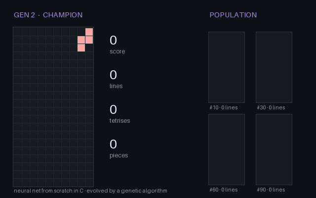

<div align="center">


<a href="https://git.io/typing-svg">
  
</a>

<br/>

[](https://www.linkedin.com/in/gustavo-alkimim-73091b24a/)
[](https://github.com/gustavoalkimim)
[](https://github.com/gustavoalkimim?tab=followers)

</div>

<br/>

## 👨‍💻 About Me

```yaml
student:
  name: "Gustavo Alkimim"
  course: "Computer Science"
  focus: ["C", "C++", "Software Engineering", "Problem Solving"]
  currently_learning: ["Data Structures & Algorithms", "Artificial Intelligence", "OOP"]
  motto: "Turning curiosity into code, one project at a time."
```

- 🎓 Computer Science student, passionate about building things from the ground up.
- 🔭 Currently sharpening my fundamentals in **C / C++**, low-level programming, and clean software design.
- 🌱 Actively studying **Data Structures & Algorithms**, **AI**, and **Software Engineering** practices.
- 🤝 Open to academic collaborations, study groups, and small open-source contributions.
- 🤖 This profile is intentionally automated — the stats, activity, and simulation below update themselves via scheduled GitHub Actions.

<br/>

## 🛠️ Tech Stack

**Languages**
<br/>


**Tools, Build & DevOps**
<br/>


**Graphics, UI & Game Dev**
<br/>


**Design & Data**
<br/>


<br/>

## 📊 GitHub Analytics

> Generated daily via GitHub Actions ([lowlighter/metrics](https://github.com/lowlighter/metrics)).

<div align="center">


</div>

<br/>

## 🤖 Live Activity
> Auto-updated every 6 hours via GitHub Actions.

<!--START_SECTION:activity-->
1. 🌿 Created branch `Gustavo_Henrique` in [ICEI-PUC-Minas-CC-TI/TI2-Projeto-HUB](https://github.com/ICEI-PUC-Minas-CC-TI/TI2-Projeto-HUB) · 18/10
2. ⬆️ Pushed 1 commit to [gustavoalkimim/Portifolio](https://github.com/gustavoalkimim/Portifolio) · 14/10
3. 🌿 Created branch `main` in [gustavoalkimim/Portifolio](https://github.com/gustavoalkimim/Portifolio) · 14/10
4. 🌿 Created branch `esquema-sql-dbml` in [ICEI-PUC-Minas-CC-TI/TI2-Projeto-HUB](https://github.com/ICEI-PUC-Minas-CC-TI/TI2-Projeto-HUB) · 01/10
5. ⬆️ Pushed 1 commit to [gustavoalkimim/Prova_de_DIW](https://github.com/gustavoalkimim/Prova_de_DIW) · 22/09
<!--END_SECTION:activity-->

<br/>

## 🧬 Conway's Game of Life
> Seeded from my real contribution history · regenerated every Monday via GitHub Actions.

<div align="center">

</div>

<br/>

## ♟️ Community Chess vs. My C Engine
> Everyone plays White together, one move per issue · my chess engine, written from scratch in C, plays Black.

<div align="center">

</div>

<!--START_SECTION:chess-->
**It's your move — you play White.** Click a move: it opens a pre-filled issue, just hit **Create**. A GitHub Action validates it, my engine replies and the board updates in about a minute.

| Piece | Moves |
| :--- | :--- |
| ♘ Knight | [`Na3`](https://github.com/gustavoalkimim/gustavoalkimim/issues/new?title=chess%7Cmove%7Cb1a3&body=Just%20click%20%2A%2ACreate%2A%2A%20%E2%80%94%20a%20GitHub%20Action%20plays%20your%20move%20and%20my%20engine%20answers.%20Don%27t%20edit%20the%20title%21) [`Nc3`](https://github.com/gustavoalkimim/gustavoalkimim/issues/new?title=chess%7Cmove%7Cb1c3&body=Just%20click%20%2A%2ACreate%2A%2A%20%E2%80%94%20a%20GitHub%20Action%20plays%20your%20move%20and%20my%20engine%20answers.%20Don%27t%20edit%20the%20title%21) [`Nf3`](https://github.com/gustavoalkimim/gustavoalkimim/issues/new?title=chess%7Cmove%7Cg1f3&body=Just%20click%20%2A%2ACreate%2A%2A%20%E2%80%94%20a%20GitHub%20Action%20plays%20your%20move%20and%20my%20engine%20answers.%20Don%27t%20edit%20the%20title%21) [`Nh3`](https://github.com/gustavoalkimim/gustavoalkimim/issues/new?title=chess%7Cmove%7Cg1h3&body=Just%20click%20%2A%2ACreate%2A%2A%20%E2%80%94%20a%20GitHub%20Action%20plays%20your%20move%20and%20my%20engine%20answers.%20Don%27t%20edit%20the%20title%21) |
| ♙ Pawn | [`a3`](https://github.com/gustavoalkimim/gustavoalkimim/issues/new?title=chess%7Cmove%7Ca2a3&body=Just%20click%20%2A%2ACreate%2A%2A%20%E2%80%94%20a%20GitHub%20Action%20plays%20your%20move%20and%20my%20engine%20answers.%20Don%27t%20edit%20the%20title%21) [`a4`](https://github.com/gustavoalkimim/gustavoalkimim/issues/new?title=chess%7Cmove%7Ca2a4&body=Just%20click%20%2A%2ACreate%2A%2A%20%E2%80%94%20a%20GitHub%20Action%20plays%20your%20move%20and%20my%20engine%20answers.%20Don%27t%20edit%20the%20title%21) [`b3`](https://github.com/gustavoalkimim/gustavoalkimim/issues/new?title=chess%7Cmove%7Cb2b3&body=Just%20click%20%2A%2ACreate%2A%2A%20%E2%80%94%20a%20GitHub%20Action%20plays%20your%20move%20and%20my%20engine%20answers.%20Don%27t%20edit%20the%20title%21) [`b4`](https://github.com/gustavoalkimim/gustavoalkimim/issues/new?title=chess%7Cmove%7Cb2b4&body=Just%20click%20%2A%2ACreate%2A%2A%20%E2%80%94%20a%20GitHub%20Action%20plays%20your%20move%20and%20my%20engine%20answers.%20Don%27t%20edit%20the%20title%21) [`c3`](https://github.com/gustavoalkimim/gustavoalkimim/issues/new?title=chess%7Cmove%7Cc2c3&body=Just%20click%20%2A%2ACreate%2A%2A%20%E2%80%94%20a%20GitHub%20Action%20plays%20your%20move%20and%20my%20engine%20answers.%20Don%27t%20edit%20the%20title%21) [`c4`](https://github.com/gustavoalkimim/gustavoalkimim/issues/new?title=chess%7Cmove%7Cc2c4&body=Just%20click%20%2A%2ACreate%2A%2A%20%E2%80%94%20a%20GitHub%20Action%20plays%20your%20move%20and%20my%20engine%20answers.%20Don%27t%20edit%20the%20title%21) [`d3`](https://github.com/gustavoalkimim/gustavoalkimim/issues/new?title=chess%7Cmove%7Cd2d3&body=Just%20click%20%2A%2ACreate%2A%2A%20%E2%80%94%20a%20GitHub%20Action%20plays%20your%20move%20and%20my%20engine%20answers.%20Don%27t%20edit%20the%20title%21) [`d4`](https://github.com/gustavoalkimim/gustavoalkimim/issues/new?title=chess%7Cmove%7Cd2d4&body=Just%20click%20%2A%2ACreate%2A%2A%20%E2%80%94%20a%20GitHub%20Action%20plays%20your%20move%20and%20my%20engine%20answers.%20Don%27t%20edit%20the%20title%21) [`e3`](https://github.com/gustavoalkimim/gustavoalkimim/issues/new?title=chess%7Cmove%7Ce2e3&body=Just%20click%20%2A%2ACreate%2A%2A%20%E2%80%94%20a%20GitHub%20Action%20plays%20your%20move%20and%20my%20engine%20answers.%20Don%27t%20edit%20the%20title%21) [`e4`](https://github.com/gustavoalkimim/gustavoalkimim/issues/new?title=chess%7Cmove%7Ce2e4&body=Just%20click%20%2A%2ACreate%2A%2A%20%E2%80%94%20a%20GitHub%20Action%20plays%20your%20move%20and%20my%20engine%20answers.%20Don%27t%20edit%20the%20title%21) [`f3`](https://github.com/gustavoalkimim/gustavoalkimim/issues/new?title=chess%7Cmove%7Cf2f3&body=Just%20click%20%2A%2ACreate%2A%2A%20%E2%80%94%20a%20GitHub%20Action%20plays%20your%20move%20and%20my%20engine%20answers.%20Don%27t%20edit%20the%20title%21) [`f4`](https://github.com/gustavoalkimim/gustavoalkimim/issues/new?title=chess%7Cmove%7Cf2f4&body=Just%20click%20%2A%2ACreate%2A%2A%20%E2%80%94%20a%20GitHub%20Action%20plays%20your%20move%20and%20my%20engine%20answers.%20Don%27t%20edit%20the%20title%21) [`g3`](https://github.com/gustavoalkimim/gustavoalkimim/issues/new?title=chess%7Cmove%7Cg2g3&body=Just%20click%20%2A%2ACreate%2A%2A%20%E2%80%94%20a%20GitHub%20Action%20plays%20your%20move%20and%20my%20engine%20answers.%20Don%27t%20edit%20the%20title%21) [`g4`](https://github.com/gustavoalkimim/gustavoalkimim/issues/new?title=chess%7Cmove%7Cg2g4&body=Just%20click%20%2A%2ACreate%2A%2A%20%E2%80%94%20a%20GitHub%20Action%20plays%20your%20move%20and%20my%20engine%20answers.%20Don%27t%20edit%20the%20title%21) [`h3`](https://github.com/gustavoalkimim/gustavoalkimim/issues/new?title=chess%7Cmove%7Ch2h3&body=Just%20click%20%2A%2ACreate%2A%2A%20%E2%80%94%20a%20GitHub%20Action%20plays%20your%20move%20and%20my%20engine%20answers.%20Don%27t%20edit%20the%20title%21) [`h4`](https://github.com/gustavoalkimim/gustavoalkimim/issues/new?title=chess%7Cmove%7Ch2h4&body=Just%20click%20%2A%2ACreate%2A%2A%20%E2%80%94%20a%20GitHub%20Action%20plays%20your%20move%20and%20my%20engine%20answers.%20Don%27t%20edit%20the%20title%21) |

<sub>Engine: 0x88 board, PVS alpha-beta with transposition table, null-move pruning, LMR and quiescence search — [source](./chess/engine) · [how it works](./chess/README.md)</sub>
<!--END_SECTION:chess-->

<br/>

## 🧠 Tetris AI, Learning in Public
> A neural network written from scratch in C and evolved by a genetic algorithm — no human games, no hand-tuned weights. It started from random weights and trains 2 more generations every Monday.

<div align="center">

<br/>

</div>

<!--START_SECTION:tetris-->
| Generation | Training for | Best fitness | Record | Champion (showcase game) |
| :---: | :---: | :---: | :---: | :---: |
| **2** | 0 weeks | 31,626 | 35,265 (gen 1) | 227 lines · 0 tetrises |

<sub>8 board features → 8 hidden neurons → 1 move score. 100 networks per generation, each plays 3 games of up to 1,000 pieces; the best 5 survive and the rest are bred by tournament selection, crossover and mutation — [source](./tetris/engine) · [how it works](./tetris/README.md)</sub>
<!--END_SECTION:tetris-->

<br/>

## 🚀 Projetos Principais

- **[PetVet](https://github.com/gustavoalkimim/petvet)** — MVP de uma startup B2B2C (clínica veterinária → tutor de pet). Backend Java/Spring Boot com JWT e camada de segurança, frontend React + TypeScript. Projeto real, ainda incompleto, com bugs conhecidos documentados no próprio README.
- **[SecureLoginPUC](https://github.com/gustavoalkimim/secureloginpuc)** — Autenticação com Spring Security (login, BCrypt, controle de papel admin/usuário). Cadastro e recuperação de senha ainda são apenas interface, sem persistência.
- **[Fisiogrip](https://github.com/Mavilaa/Fisiogrip)** — Projeto em equipe (colaborador): carteirinha digital de acompanhamento de fisioterapia, feito em MIT App Inventor.
- **[Soc Ops](https://github.com/gustavoalkimim/socops-microsoft-workshop)** — Bingo social para dinâmicas de equipe, feito em workshop da Microsoft com GitHub Copilot em fluxo multi-agente.

<br/>

## 🌱 Currently Learning

| Topic | Status |
|---|---|
| Data Structures & Algorithms | 🟣 In progress |
| Artificial Intelligence | 🟣 In progress |
| Software Engineering | 🟣 In progress |
| Object-Oriented Programming | 🟣 In progress |

<br/>

## 📫 Connect

<div align="center">

[](https://www.linkedin.com/in/gustavo-alkimim-73091b24a/)
[](https://github.com/gustavoalkimim)

</div>

<div align="center">

*"Turning curiosity into code, one project at a time."* 🚀


</div>
